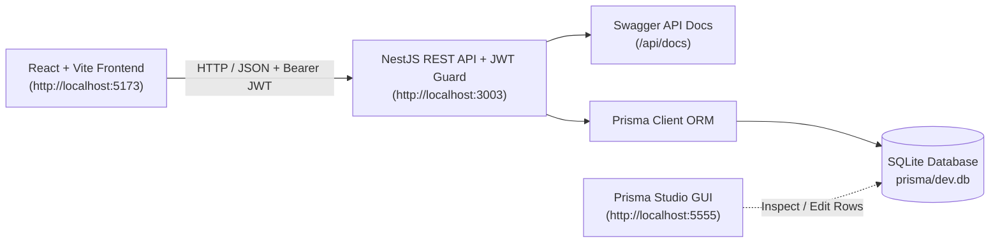

# ExhibitionApp — Fullstack Exhibition & Lead Management Platform

A fullstack web application for managing trade-show exhibitions, capturing booth visitor leads, tracking product interests and gift disbursements, managing teams/organizations, and exporting Excel reports.

Built with **NestJS**, **Prisma ORM**, **SQLite**, **JWT Authentication**, **Swagger (OpenAPI)**, and a **React + TypeScript + Vite** frontend inside the same repository.

---

## Key Features

- **Authentication & Security**
  - JWT Bearer authentication protecting all API endpoints by default (with explicit `@Public()` routes for login, registration, health check, and API docs).
  - Password hashing with `bcryptjs` (passwords are never stored in plaintext and never returned in API responses).
  - Request DTO validation via `class-validator` and global NestJS `ValidationPipe`.
  - Organization self-registration (`POST /auth/register`) that creates an organization, default Admin role, default SBU, admin user, and subscription inside a single database transaction.
- **Exhibition Campaigns Management**
  - Create, search, edit, and delete exhibition campaigns with campaign types, schedules, objectives, and dependent State/District location selectors.
- **Visitor Lead Capture & Excel Reporting**
  - Record booth visitors with company details, contact info (`VisitorDetails`), interested products & machine counts (`VisitorIntProduct`), financing requirements, purchase timeline, and gift tracking.
  - One-click **Export to Excel (`.xlsx`)** via `GET /visitor-master/export-excel` powered by `exceljs`.
- **Product Catalog & Team Management**
  - Manage product families, products, product models, strategic business units (SBUs), roles, and team member active/inactive status.
- **Interactive API Documentation**
  - Built-in Swagger UI available at `http://localhost:3003/api/docs`.
- **Zero-Setup Local Database**
  - Uses local **SQLite (`prisma/dev.db`)** via Prisma ORM with a comprehensive seed script so anyone can run and grade the app immediately without installing SQL Server or Docker.

---

## Tech Stack

| Layer | Technology |
| --- | --- |
| **Frontend** | React 19, TypeScript, Vite, Lucide Icons, Responsive CSS |
| **Backend API** | NestJS 10, TypeScript, Passport JWT, `bcryptjs`, `class-validator`, `exceljs`, `@nestjs/swagger` |
| **Database & ORM** | Prisma 5 (Multi-file schema in `prisma/schema/`), SQLite (`prisma/dev.db`) |
| **Testing** | Jest + `@nestjs/testing` |

---

## Architecture Overview



---

## Project Structure

```text
.
├── frontend/                   # React + TypeScript + Vite web application
│   ├── src/
│   │   ├── api/client.ts       # Typed fetch wrapper (JWT auth + Excel download)
│   │   ├── components/         # Layout & sidebar navigation
│   │   ├── context/            # AuthContext (session, login, register, logout)
│   │   ├── pages/              # Login, Register, Dashboard, Campaigns, Visitors, Products, Users
│   │   ├── App.tsx
│   │   └── styles.css
│   ├── package.json
│   └── vite.config.ts
├── prisma/
│   ├── schema/                 # 22 modular Prisma schema files (datasource: sqlite)
│   ├── model/                  # Seed reference data (states, districts, menus, versions)
│   ├── seed.ts                 # Idempotent demo data seeder (bcrypt-hashed users)
│   └── dev.db                  # Auto-generated local SQLite database (gitignored)
├── src/
│   ├── auth/                   # JWT strategy, global JwtAuthGuard, @Public(), AuthController/Service
│   ├── campaign-master/        # Exhibition campaigns CRUD
│   ├── visitor-master/         # Visitor lead capture CRUD + Excel export
│   ├── product-master/         # Product catalog CRUD
│   ├── product-family-master/  # Product families CRUD
│   ├── user-master/            # Users CRUD, bcrypt hashing, sanitized responses
│   ├── organization-master/    # Organization management
│   ├── role-master/            # Roles & menu permissions
│   ├── sbu-master/             # Strategic business units
│   ├── subscription-master/    # Plans & subscriptions
│   ├── app.module.ts
│   └── main.ts                 # CORS, ValidationPipe, Swagger setup
├── .env.example                # Environment variable template
└── package.json                # Root backend + fullstack orchestration scripts
```

---

## Prerequisites

- **Node.js** `v18+` (recommended `v20+`) and **npm** `v9+`
- *(Optional)* `sqlite3` CLI if you want to query the database from your terminal

---

## How to Run Locally (Step-by-Step)

### 1. Install Backend & Frontend Dependencies

From the project root directory:

```bash
# Install backend dependencies
npm install

# Install frontend dependencies
npm run frontend:install
```

### 2. Configure Environment Variables

Copy `.env.example` to `.env` (if `.env` does not already exist):

```bash
cp .env.example .env
```

Default `.env` values work out-of-the-box for local development:

```env
DATABASE_URL="file:../dev.db"
PORT=3003
JWT_SECRET="exhibition-app-local-jwt-secret-change-me"
JWT_EXPIRES_IN="7d"
FRONTEND_URL="http://localhost:5173"
```

### 3. Initialize & Seed the Local Database

Run the one-command database setup script (generates Prisma Client, creates `prisma/dev.db` tables, and inserts demo data):

```bash
npm run db:setup
```

### 4. Start the Fullstack App (Backend + Frontend)

Run both servers together with a single command:

```bash
npm run dev
```

Or run them in two separate terminals:

```bash
# Terminal 1 — NestJS Backend API (http://localhost:3003)
npm run start:dev

# Terminal 2 — React + Vite Frontend (http://localhost:5173)
npm run frontend:dev
```

### 5. Open the Application

| Service | URL |
| --- | --- |
| **Web Frontend** | [http://localhost:5173](http://localhost:5173) |
| **Backend REST API** | [http://localhost:3003](http://localhost:3003) |
| **API Health Check** | [http://localhost:3003/health](http://localhost:3003/health) |
| **Swagger Interactive Docs** | [http://localhost:3003/api/docs](http://localhost:3003/api/docs) |

### Demo Login Credentials

You can click **"Auto-fill"** on the login page or enter these seeded credentials:

| Role | Email | Password |
| --- | --- | --- |
| **Admin** | `admin@exhibition.local` | `Admin@123` |
| **Booth Staff** | `staff@exhibition.local` | `Staff@123` |

You can also click **"Create an account"** on the login page to register a brand-new organization and admin user.

---

## How to Check Entries in the Database Locally

Because this project uses a local SQLite database file stored at `prisma/dev.db`, you can inspect, filter, and verify all database records in **three easy ways**:

### Method 1: Prisma Studio (Recommended — Visual Web GUI)

Run the following command in a new terminal from the project root:

```bash
npm run db:studio
```

Open **[http://localhost:5555](http://localhost:5555)** in your browser.
- You will see all 20+ models (`UserMaster`, `OrganizationMaster`, `CampaignMaster`, `VisitorMaster`, `VisitorDetails`, `ProductMaster`, `SubscriptionMaster`, etc.).
- Click any model to view live rows, search/filter records, edit fields, or verify newly created campaigns/visitors right after submitting a form in the web UI.

### Method 2: SQLite Command Line (`sqlite3`)

You can query `prisma/dev.db` directly from your terminal:

```bash
sqlite3 prisma/dev.db
```

Inside the `sqlite3>` prompt, turn on readable table formatting and run SQL queries:

```sql
.headers on
.mode column

-- List all tables in the database
.tables

-- View registered organizations
SELECT id, orgName, orgEmail, orgMobileNo, status FROM OrganizationMaster;

-- View users (notice passwords are stored as bcrypt hashes!)
SELECT id, username, email, roleId, status, substr(password, 1, 15) AS passwordHashPrefix FROM UserMaster;

-- View exhibition campaigns
SELECT id, campaignName, fromDate, toDate, location, status FROM CampaignMaster;

-- View captured visitor leads with contact details
SELECT
  v.id,
  v.companyName,
  d.visitorName,
  d.email,
  d.mobileNo,
  v.planningTimeline,
  v.giftDetails
FROM VisitorMaster v
LEFT JOIN VisitorDetails d ON d.visitorMasterId = v.id;

-- View products and their families
SELECT p.id, p.productCode, p.productName, f.productFamilyName
FROM ProductMaster p
JOIN ProductFamilyMaster f ON p.productFamilyId = f.id;

-- Exit sqlite3
.quit
```

Or run a quick one-liner without entering interactive mode:

```bash
sqlite3 -header -column prisma/dev.db "SELECT id, campaignName, fromDate, toDate, location FROM CampaignMaster;"
```

### Method 3: VS Code Extension

1. Install the **SQLite Viewer** extension in VS Code.
2. Click `prisma/dev.db` in the VS Code file explorer to browse every table visually inside your editor.

### Resetting & Re-seeding the Local Database

If you want a completely fresh database at any time:

```bash
rm -f prisma/dev.db prisma/dev.db-journal
npm run db:setup
```

---

## Core API Endpoints

All endpoints except `/health`, `/auth/login`, `/auth/register`, and `/api/docs` require an `Authorization: Bearer <token>` header.

| Method | Endpoint | Description | Auth |
| --- | --- | --- | --- |
| `GET` | `/health` | Service health status | Public |
| `POST` | `/auth/login` | Sign in and obtain JWT access token | Public |
| `POST` | `/auth/register` | Register a new organization + admin account | Public |
| `GET` | `/auth/me` | Get authenticated user profile, menus & subscription | Bearer JWT |
| `GET/POST/PATCH/DELETE` | `/campaign-master` | Manage exhibition campaigns | Bearer JWT |
| `GET/POST/PATCH/DELETE` | `/visitor-master` | Capture and manage visitor leads | Bearer JWT |
| `GET` | `/visitor-master/export-excel` | Download visitor leads as `.xlsx` spreadsheet | Bearer JWT |
| `GET/POST/PATCH/DELETE` | `/product-master` | Manage exhibition products | Bearer JWT |
| `GET/POST/PATCH/DELETE` | `/product-family-master` | Manage product families | Bearer JWT |
| `GET/POST/PATCH/DELETE` | `/user-master` | Manage organization team members | Bearer JWT |
| `GET` | `/state-master`, `/district-master`, `/campaign-type-master`, `/industry-type-master`, `/role-master`, `/sbu-master` | Lookup/master reference data | Bearer JWT |

Explore and test every endpoint directly in Swagger UI at **[http://localhost:3003/api/docs](http://localhost:3003/api/docs)** (click **Authorize** and paste your JWT token from `/auth/login`).

---

## Testing & Production Builds

```bash
# Run backend unit tests
npm test

# Build backend for production
npm run build

# Type-check and build frontend for production
npm run frontend:build
```

---

## Troubleshooting

- **Port already in use (`3003` or `5173`)**: Change `PORT` in `.env` (and set `VITE_API_URL=http://localhost:<PORT>` if changing the backend port), or stop the process using that port.
- **Prisma Client out of sync**: Run `npm run db:setup` to regenerate Prisma Client and synchronize `prisma/dev.db`.
- **Unauthorized (`401`) errors in Swagger**: Call `POST /auth/login` first, copy `message.accessToken`, click **Authorize** at the top right of Swagger UI, and paste the token.
